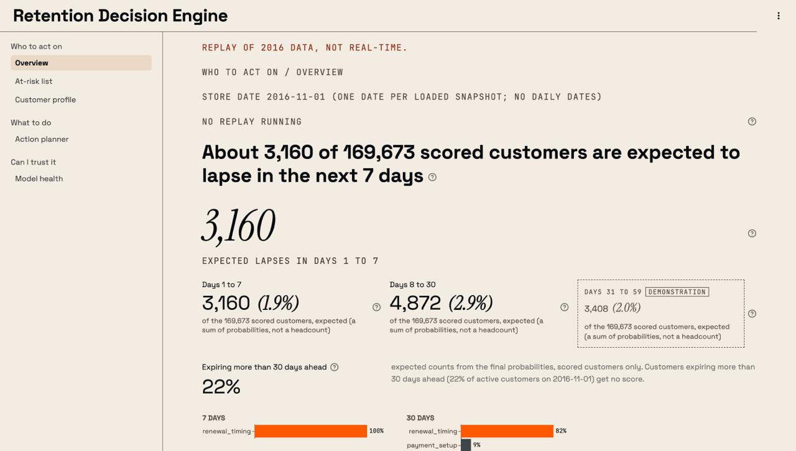
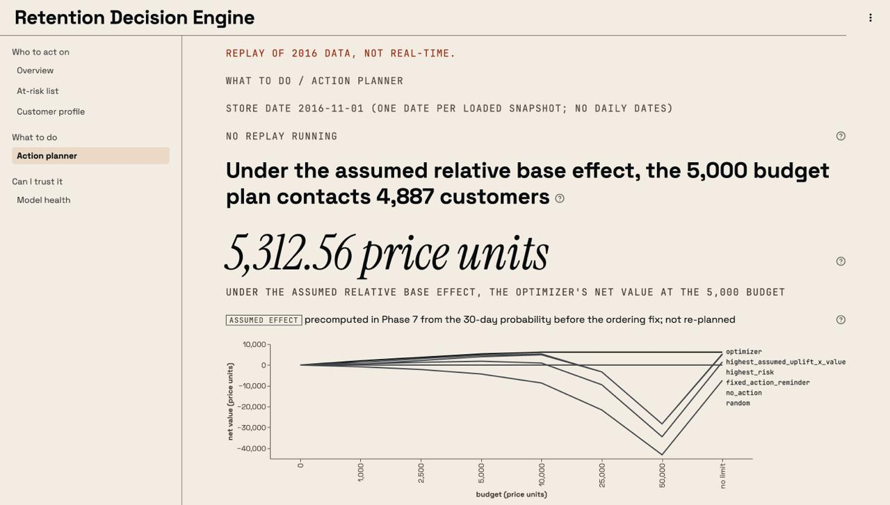
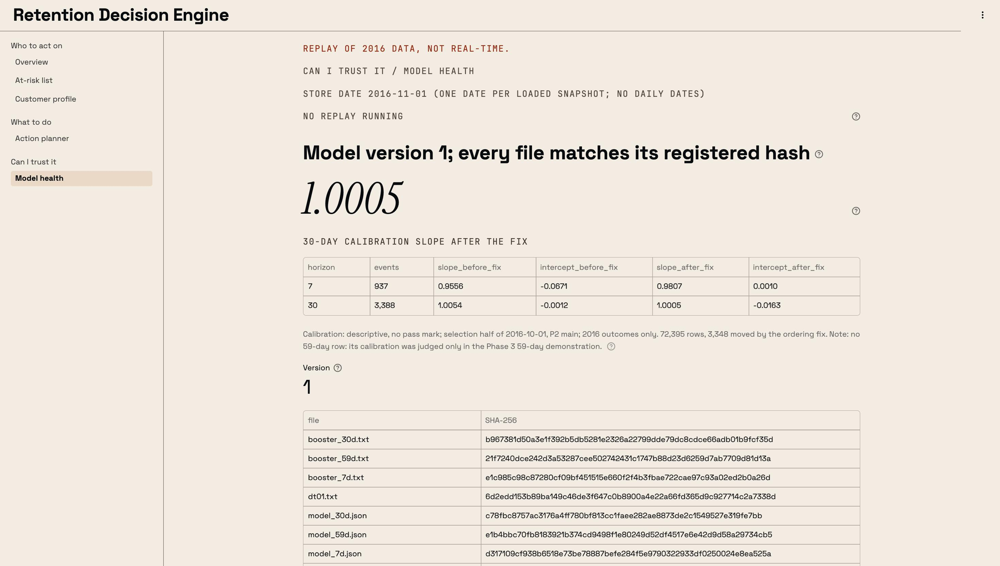
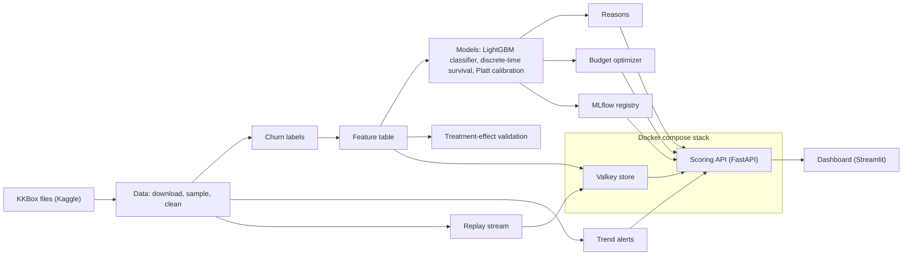

# Retention decision engine

[](https://github.com/notsushmit/retention-engine/actions/workflows/ci.yml) [](LICENSE)

A churn-prediction and retention-planning project built on a replay of 2016 KKBox music-subscription data: a portfolio project, not a hosted service.

Predicts which subscribers will churn and when, shows what drives each prediction, compares retention actions under assumed effects, and allocates a retention budget. The primary data is the KKBox churn prediction challenge (WSDM Cup 2018).

A customer is anyone with at least one paid transaction or a full discount on a priced plan. Free trials and free promotional periods alone do not count.

Everything runs on recorded 2016 data replayed through the service, with one snapshot date (2016-11-01), and every action value rests on assumed effects, because no KKBox discount effect was identified.

<p></p>

*Overview: expected lapses by window and what the model sees in the 1,000 customers most at risk. Replayed 2016 data, one store date (2016-11-01); the 59-day window is a demonstration.*

<table>
  <tr>
    <td width="50%"></td>
    <td width="50%"></td>
  </tr>
  <tr>
    <td><em>Action planner: plans precomputed for the store date; every value rests on assumed effects.</em></td>
    <td><em>Model health: the registered model's file hashes and its calibration on one month of 2016; drift is not monitored yet.</em></td>
  </tr>
</table>

Page by page, with every caveat: [docs/dashboard.md](docs/dashboard.md).

## Contents

- [Headline results](#headline-results)
- [Quick start](#quick-start)
- [Architecture](#architecture)
- [Tech stack](#tech-stack)
- [How it was built](#how-it-was-built)
- [Scoring service](#scoring-service)
- [Limitations](#limitations)
- [Full setup](#full-setup)
- [Repository layout](#repository-layout)
- [Data and licence](#data-and-licence)
- [Acknowledgements](#acknowledgements)

## Headline results

| Result | Figure | Caveat | Source |
| --- | --- | --- | --- |
| 30-day discrimination of the LightGBM classifier, test month 2017-01 | AUC 0.8429 [0.8374, 0.8484], against 0.7687 for the strongest simple baseline | one test month; the interval covers which customers were in it, not month-to-month change | [model comparison](reports/model_comparison.md) |
| Survival model against the classifier at 7 days | AUC difference -0.0339 in 2017-01 and -0.0527 in 2017-02 | the survival model was worse; its registered goal at 7 days was not met | [model comparison](reports/model_comparison.md) |
| Replayed store against batch scoring | 169,673 scored customers, largest gap 0.0 | one store date (2016-11-01); over HTTP, 996 of 1,000 answers matched as written, and 1,000 of 1,000 only under amendment A10 | [serving parity](reports/serving_parity.md) |
| Scoring latency over HTTP | p95 69.429 ms over 1,000 calls | one run on one Mac, before the 1.5 GiB memory limit and the dashboard endpoints; the 100 ms threshold is unvalidated | [serving parity](reports/serving_parity.md) |
| Budget plan at 5,000 price units, 2016-11-01 | optimizer net value 5,313, against 3,995 for contacting the highest risk | assumed effects; the optimizer maximizes this quantity by design; the plan is unstable under 5 of 11 variants | [strategy backtest](reports/strategy_backtest.md) |

## Quick start

The repository holds code, configs and docs, not data. These commands assume the KKBox data and the models have been built locally (see [Full setup](#full-setup)).

```bash
uv sync --group dev --group training --group api --group dashboard
make up
uv run python -m retention.api load-snapshot --snapshot 2016-11-01
make dashboard
make test
```

- `uv sync` needs [uv](https://docs.astral.sh/uv/); it installs Python 3.11 and every dependency from `uv.lock`.
- `make up` needs Docker; it starts Valkey on 127.0.0.1:6379 and the scoring API on 127.0.0.1:8000.
- `load-snapshot` needs the processed 20% sample and the registered models; Valkey stores nothing on disk, so after any restart the store is empty, and a load after the first one needs `--reload-reason "<why>"`.
- `make dashboard` needs the API to be ready; it serves the dashboard on 127.0.0.1:8501 only.
- `make test` runs ruff and pytest; tests that need the local data skip without it.

## Architecture



The raw KKBox files are downloaded from Kaggle, sampled to 20% of customers and typed. Churn labels are built from each customer's membership timeline, and a feature table describes each customer at each monthly snapshot using only rows dated before it. A LightGBM classifier gives the 7, 30 and 59-day probabilities (the 59-day one is a demonstration), a discrete-time survival model gives the shape of the curve used for value, and Platt calibration with an ordering fix makes the three probabilities consistent. The reasons come from the classifier's per-feature contributions; trend alerts come from change points in the weekly churn rate; the treatment-effect work validated its method on two public randomized datasets but found no usable KKBox effect, so the budget optimizer uses assumed effects. The models are registered in MLflow, and the scoring API, running beside a Valkey store in a Docker Compose stack, loads them by alias. Valkey also carries the replay stream that feeds recorded 2016 rows through the service. The dashboard reads only the scoring API.

## Tech stack

| Tool | Role | Where it is used |
| --- | --- | --- |
| Python 3.11 and uv | language; locked environments | everywhere; `pyproject.toml`, `uv.lock`, the `Dockerfile` |
| DuckDB, pandas, NumPy, PyArrow | SQL over CSV and Parquet; tables | `src/retention/data`, `labels`, `features` and throughout |
| Kaggle CLI, py7zr | downloading and extracting the competition files | `src/retention/data` |
| LightGBM | the classifier and its per-feature contributions | `src/retention/models`, `explain`, `api` |
| scikit-learn | baselines, calibration, propensity models, archetype clustering | `src/retention/models`, `explain` and the treatment-effect code |
| lifelines, XGBoost | survival candidates (Cox, accelerated failure time) | `src/retention/models` |
| SciPy | the HiGHS check of the optimizer's plans; trend statistics | `src/retention/optimize`, `trends` |
| ruptures | change-point detection | `src/retention/trends` |
| MLflow | run tracking and the model registry | `src/retention/models`, `src/retention/api/registry.py` |
| FastAPI, Pydantic, Uvicorn | the scoring API and its response schemas | `src/retention/api` |
| Valkey (redis client) | the scoring store and the replay stream | `src/retention/api/store.py`, `src/retention/stream`, `docker-compose.yml` |
| Streamlit, Altair, httpx | the dashboard, its charts, its API client | `dashboard/` |
| Docker Compose | the Valkey and API stack | `docker-compose.yml`, `Dockerfile` |
| pytest, ruff, pre-commit, GitHub Actions | tests, linting, CI | `tests/`, `.pre-commit-config.yaml`, `.github/workflows/ci.yml` |

## How it was built

| Phase | What was built | Read more |
| --- | --- | --- |
| 0 | data download, a 20% customer sample, data-quality checks | [setup](docs/setup.md) |
| 1 | the churn definition and labels, checked against the competition labels | [churn definition](docs/churn_definition.md) |
| 2 | a leakage-safe feature table for every monthly snapshot | [features](docs/features.md) |
| 3 | classifier, survival and baseline models, scored once on the test months | [model comparison](reports/model_comparison.md) |
| 4 | per-customer reasons; churn archetypes were tried and none held up | [archetypes](docs/archetypes.md) |
| 5 | change-point detection on the weekly churn rate, with exploratory alerts | [change points](docs/changepoints.md) |
| 6 | treatment effects and counterfactuals; the method was checked on public randomized data, and no KKBox effect could be estimated | [effect validation](docs/uplift_validation.md), [causal assumptions](docs/causal_assumptions.md), [counterfactuals](docs/counterfactuals.md) |
| 7 | the budget optimizer under assumed effects, with a strategy backtest | [strategy backtest](reports/strategy_backtest.md) |
| 8 | the replay stream, the scoring API and the Docker stack | [scoring API](docs/scoring_api.md), [serving parity](reports/serving_parity.md) |
| 9 | the dashboard | [dashboard](docs/dashboard.md) |

Every phase was registered before it ran. Pass marks, populations and settings were written to a config file and committed alone before any code or run they judge, and they were never edited after a result was seen. A mark that failed is reported as not met. When a rule turned out to be wrong, the change was added as a labelled amendment that says whether it was written before or after the result, and the original result stays on record; HTTP parity under amendment A10, written after the 996 of 1,000 result, is one example. Every number in a report or doc comes from a logged run, and tests check the public texts against those numbers and against the wording rules.

## Scoring service

> The service replays 2016 KKBox data; there is no live source.
>
> Customers expiring more than 30 days ahead (22% of active customers on 2016-11-01) get no score.
>
> Plans exist for two dates only (2016-10-01 and 2016-11-01) and were built from the 30-day probability before the ordering fix.
>
> KKBox backtest figures are model estimates under assumed effects, not observed outcomes.

A FastAPI service answers `GET /health`, `POST /score`, `GET /at-risk` and `GET /alerts` from a Valkey store loaded for one snapshot date, 2016-11-01. The models load from the MLflow registry alias `retention-scoring@serving`, and every model file is checked by SHA-256 at startup and on every call. Risk is given at 7, 30 and 59 days, one day short of the phase plan's 60-day horizon; every 59-day probability is marked as a demonstration. Endpoints and fields: [docs/scoring_api.md](docs/scoring_api.md); every comparison with batch scoring: [reports/serving_parity.md](reports/serving_parity.md).

```bash
make up    # Valkey on 127.0.0.1:6379 and the API on 127.0.0.1:8000, then /health
uv run python -m retention.api load-snapshot --snapshot 2016-11-01
make down
```

Valkey writes nothing to disk, so the store is empty after any restart and `/health` answers 503 until the snapshot is loaded again from the host; a load after the first one needs `--reload-reason`.

Parity over HTTP: the registered mark compared 1,000 seeded answers from the container with the host's answers as exact strings, and it was not met: 996 of 1,000 matched. The other 4 differed only in float values, at most 4 ulps apart (the smallest steps a float can take), with no text, action name or flag different; the likely source, untested, is the container's Linux libraries against the Mac's. Amendment A10, written after that result was seen, judges floats within a relative 1e-12 and every other field exactly; under it all 1,000 pass, and the 996 of 1,000 stays on record as not met as written. Step 6's score parity is a separate result: on all 169,673 scored rows of 2016-11-01 the replayed store gave the same scores as batch within the registered tolerance (final probabilities within a relative 1e-12; the largest gap was 0.0). The HTTP sample was 1,000 of the 169,673 scored customers (0.6%), drawn with one seed, scored customers only, at one store date; outside_population and not_active answers are covered by neither the parity mark nor the step 8 HTTP checks, and were checked in-process only (the tests and the step 5 smoke run, not over HTTP).

Latency, p95 on this Mac, one run of 1,000 calls: p95 69.429 ms, with p99 97.809 ms and a maximum of 108.142 ms, measured before the 1.5 GiB limit and before the dashboard endpoints, over loopback with one client and one connection, against a threshold of 100 ms (my unvalidated choice). The p50 was 59.242 ms. Every timed call includes the service's check of its model and pinned files, about 15 ms in an earlier in-process measurement.

Memory: the API container is limited to 1.5 GiB, my choice. After one filtered `GET /at-risk` call it used 672.4 MiB, measured with swap above 0 (97.38 MB) and no concurrent clients; the filter index together with 8 concurrent clients was not measured, so the headroom is not established.

Unverified: `ps` showed Docker's VM process at 9.83 GB resident, above the VM's 7.75 GiB, while free memory read 74% and swap 0, and this is not explained; the API image is listed at 1.47GB by `docker images` and at 322,050,115 bytes by `docker image inspect`, and the two sizes are not reconciled. The figures 672.4 MiB, 97.38 MB and 9.83 GB are console readings (docker stats, sysctl, ps) with no report written to disk.

## Limitations

- The data is recorded 2016 KKBox data replayed through the service, with one store date (2016-11-01) and no daily dates. The dashboard labels every page "Replay of 2016 data, not real-time."
- Plans exist for two dates only (2016-10-01 and 2016-11-01), and nothing is re-planned.
- Every action effect is an assumption, because no KKBox discount effect was identified; the plan is unstable under 5 of 11 variants.
- Every 59-day probability is a demonstration: no validation fold chose that model's settings.
- Drift is not monitored, and the models are not retrained.
- There is no hosted demo. Capture mode (`?capture=1`) hides customer IDs from screenshots but is not access control, so the dashboard must never be hosted with customer rows.
- The scores cover only paying customers expiring within 30 days: the Overview tile "Expiring more than 30 days ahead" shows 22%: 51,692 of the 230,286 customers with coverage on 2016-11-01 get no score. With the trial-only and promo-only customers, the customers outside the population are 60,613 of the same 230,286, about 26%.

## Full setup

Prerequisites: macOS or Linux, [uv](https://docs.astral.sh/uv/), Docker (Docker Desktop on macOS), the OpenMP runtime on macOS (`brew install libomp`), and a Kaggle account that has accepted the KKBox competition rules.

The data comes from Kaggle with the Kaggle CLI (`make data`); it is competition data, it is not redistributed here, and the KKBox data terms are not part of this repository. The detail (credentials, the download, the files, sizes and timings, the label and feature stages) is in [docs/setup.md](docs/setup.md).

| Target | Does |
| --- | --- |
| `make setup` | installs Python 3.11, dev dependencies and the pre-commit hook |
| `make data` | downloads, extracts and samples the KKBox data |
| `make labels` | typed tables, timelines, data-quality check, churn labels, comparison with the competition labels |
| `make test` | ruff check, ruff format check, pytest |
| `make features` | leakage-safe feature table for every labelled snapshot (docs/features.md) |
| `make train` | Phase 3 (not yet implemented) |
| `make up` | starts Valkey and the scoring API (docker compose), then prints `/health` |
| `make down` | stops them |
| `make dashboard` | serves the dashboard on 127.0.0.1:8501, reading only the API |
| `make dashboard` | serves the dashboard on 127.0.0.1:8501, reading only the API |

What each step needs: `make data` needs the Kaggle credentials and about 14 GB of disk for the 20% sample; the label, feature and model steps run on a laptop, each limited by a registered memory ceiling of 10 GB; `make up` needs Docker, with the API container limited to 1.5 GiB; every step runs once, at a clean commit.

## Repository layout

```
configs/        registered settings and pass marks (one file per area)
src/retention/  the pipeline, one package per stage: data, labels, features, models, explain, trends, the treatment-effect work, optimize, stream, api
dashboard/      the Streamlit app, its theme and the self-hosted fonts
tests/          pytest suite, including the wording and number checks of the public texts
docs/           method and design notes, setup, the scoring API, the dashboard
reports/        results generated from logged runs
data/           local data only, ignored by git
```

## Data and licence

The code, docs and configs in this repository are released under the [MIT licence](LICENSE). The KKBox files are competition data from Kaggle: they are not part of this repository, are not redistributed, and stay under the Kaggle competition rules, which anyone using them must accept. The fonts in `dashboard/static/fonts/` keep their own licence, the SIL Open Font License 1.1, as listed in `dashboard/static/fonts/SOURCES.md` with an `OFL.txt` beside each font. scikit-survival (GPL-3.0) is listed in the training group; this repository's code does not import it, and two tests use it only as a reference to cross-check the project's concordance and Brier functions.

## Acknowledgements

KKBox and Kaggle for the KKBox churn prediction challenge data (WSDM Cup 2018). The dashboard uses three self-hosted fonts, each under the SIL Open Font License 1.1: Space Grotesk (the Space Grotesk Project Authors), Instrument Serif (the Instrument Serif Project Authors) and JetBrains Mono (the JetBrains Mono Project Authors).
