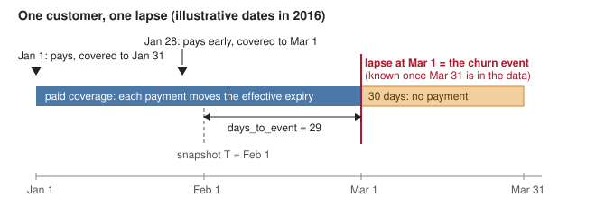

# Churn definition

**In one sentence:** a customer churns when their paid membership ends and no new subscription follows within 30 days (inclusive).

**Population:** every customer with at least one paid transaction, or a full discount on a priced plan, who has membership coverage on the snapshot date. Free trials and free promotional periods alone do not make someone a customer.

**Agreement with the competition labels** (`train.csv`, customers whose membership expires in February 2017, on a 20% customer sample). A rule that calls everyone retained agrees 94.32% of the time on the coverage-based comparison and 94.49% on the paid-based one (kappa 0), so agreement alone says little; kappa and churner recall carry the information.

| Label | Customers compared | Agreement | Kappa | Churner recall | Churner precision |
| --- | --- | --- | --- | --- | --- |
| Ours, coverage-based (primary) | 175,311 | 98.82% | 0.879 | 79.98% | 99.04% |
| Ours, paid-based | 174,641 | 98.88% | 0.882 | 80.49% | 98.95% |
| Everyone retained (baseline) | 175,311 | 94.32% | 0 | 0% | — |
| Everyone retained (baseline, paid-based group) | 174,641 | 94.49% | 0 | 0% | — |

Our definition differs from the competition labels in three ways, **by design**: renewals paid before the expiry date count; cancellations count in whatever month they fall; and, in the coverage-based family, free and fully discounted renewals count. Each difference is measured below.

## Definition in plain words



- **Effective expiry.** Walk a customer's transactions in date order. A subscription extends coverage to the later of the current expiry and its own expiry. A cancellation can only pull the expiry earlier, never later. A same-day cancel of the plan just bought only switches off auto-renew; a cancel dated after coverage has already lapsed changes nothing.
- **Same-day order.** On one day, cancels of a plan with no same-day purchase of that plan come first, then purchases. A switch to a new plan therefore keeps the new plan.
- **Lapse.** If no subscription is dated within 30 days after the effective expiry (day 30 included), coverage has lapsed at that expiry. That expiry date is the churn event.
- **As of.** Labels are built "as of" a date, by default the last transaction date, 2017-03-31. A lapse is known only when its 30-day window ends by then, so the last labelable expiry is 2017-03-01. Labels built from the full data as of a date D equal labels built from data cut at D; this is tested on synthetic customers and on the real sample (3,393,862 rows, 0 differences).
- **History.** The two transaction files are split by expiry date, not by transaction date, so every timeline uses both. Identical duplicate rows are dropped (658 in the sample).

## Population and segments

One row per customer and snapshot for every customer whose effective expiry is on or after the snapshot date T (4,306,893 rows, 398,150 customers, 24 monthly snapshots from 2015-03-01 to 2017-02-01). Only rows dated strictly before T describe the customer at T. Customers whose coverage ended in the 30 days before T and who have not yet renewed are in neither group; they are a possible win-back segment. The flag `in_exp30` marks customers expiring within 30 days; that subset is the primary evaluation population, because for everyone else the timing of a lapse is set mostly by their expiry date.

Free zero-price rows are split by actual coverage: up to 21 days is a trial, longer is a promotion. Each row carries a segment computed from rows before T: `paid`, `discount100_only`, `promo_only` or `trial_only`. Trial-only and promo-only customers churn far more than paying ones (measured once during development) and are always reported separately.

## Two label families

| Family | A renewal is | Columns | Use for |
| --- | --- | --- | --- |
| Coverage-based | any subscription row | `churned_7/30/60`, `days_to_event`, `event_observed`, `churned_classic` | churn prediction (primary) |
| Paid-based | a row with amount paid > 0 | the same with a `paid_` prefix | discount and retention-offer analysis |

In the paid-based family a free or fully discounted month does not count as a renewal, so a discount cannot mechanically produce its own "renewed" outcome. Paid-based labels exist only where paid coverage is active at T (4,214,570 of 4,306,893 rows).

## Bad dates

| Problem | Rows (sample) | Policy |
| --- | --- | --- |
| Expiry `19700101` placeholder on a purchase | 314 | expiry = transaction date + the typical coverage of that payment method and plan length in the full data (for example 3 days for method 17); flagged |
| Placeholder on a cancellation | 47 | kept as an event; never cuts coverage |
| Expiry after 2018-12-31 | 1,974 | kept; customer flagged `stacked_far_future` (repeated prepayments stacking years ahead) |
| Expiry before its own transaction date | 812 | flagged only; changes no label |

Structural problems (missing IDs, dates that do not parse, negative amounts, duplicate customers in label tables) stop the pipeline instead of being dropped silently.

## Survival target, horizons and censoring

From T, the customer is followed across renewals to the first lapse. `days_to_event` is the number of days from T to the expiry that lapsed. Follow-up is censored at the earlier of T + 90 days and the last labelable expiry; `event_observed` is 1 only if the lapse falls inside that window. Horizons beyond 90 days are not supported.

`churned_h` (h = 7, 30, 60) is 1 if the lapse falls within h days of T, and is left empty for a whole snapshot unless T + h + 30 days is on or before the as-of date. A classifier must train only on such fully observed snapshots: in a partly observed snapshot the missing rows are exactly the customers expiring near the cut-off. `churned_classic` is the competition-style label for customers expiring in the snapshot's calendar month.

## Data-quality screen

Some months are missing transactions: the month-end auto-renew billing batch is much smaller than usual (a batch ratio of 4.43 to 5.02, against 7.04 to 12.89 in the other months), and customers who appear to churn keep listening and pay again soon. Four indicators are computed for every expiry month on paying customers, each with one fixed window:

| Indicator | Fails when |
| --- | --- |
| Churn rate | above 9.10% (median + 3 MAD) |
| Churners active on 5+ of days 31-45 after the lapse | above 20.34% |
| Churners paying again on days 31-90 after the lapse | above 39.13% |
| Month-end auto-renew batch ratio | below 6.03 (the largest gap between two groups of months) |

A month with two or more failures is **unreliable**: 2015-04, 2016-03, 2016-05. A month with one failure, fewer than three assessable indicators, or a result that changes when the threshold multiplier moves by 25% is **uncertain**: 2015-01, 2015-09 to 2015-12, 2016-02, 2016-04, 2016-06, 2016-12 and 2017-03 (10 months). The other 14 months are **reliable**. Each snapshot and horizon gets the worst status of the months its window touches (`reliability_status_h`, `label_reliable_h`). For the 30-day horizon, 11 of 24 snapshots are reliable, 7 uncertain, 5 unreliable and 1 not yet observable. Metrics on reliable snapshots are primary; uncertain snapshots are a stress test; nothing is tuned on these flags. Because churn itself is one of the indicators, "churn is stable across reliable snapshots" is partly true by construction.

## Comparison with the competition labels

The published labelling script was ported exactly. It agrees with `train.csv` on 98.77% of its 171,095 candidates (kappa 0.840, churner recall 73.66%; calling everyone retained would agree 95.41% there), so `train.csv` was not produced by that script as published. Three habits explain most of the gap. They were found by looking at `train.csv`, so they are fitted to it:

| Situation (sample, February 2017 expiries) | Customers | Labelled churn in `train.csv` |
| --- | --- | --- |
| Renewal exactly 30 days after expiry | 29 | 3.45% (the script says churn) |
| Renewal 31 days after expiry | 32 | 100% |
| Renewal then a cancel in February, no later renewal | 1,153 | 71.29% |
| Renewal then a cancel in March, no later renewal | 1,730 | 3.35% |
| First renewal before the expiry, no renewal on or after it | 1,789 | 98.16% |
| Every renewal in the window paid nothing, the first a 100% discount | 91 | 96.70% |

A variant of our rule with these habits added, kept separate as `fitted_to_train` and never used as a target, reaches kappa 0.979 (coverage-based) and 0.994 (paid-based). On a disjoint 20% slice of customers, checked against criteria written down before the run, five of six criteria held: kappas 0.979 and 0.993, the same 30/31-day boundary, the same February/March cancel pattern and the same early-renewal pattern. The sixth failed: unexplained cases were 22.1% of the coverage-based variant's disagreements against a 20% limit.

Our own coverage-based labels disagree with `train.csv` on 2,070 customers. Each gets one reason code: early renewal 1,645; renewal that changed plan 148; zero-paid renewal 124; March cancel 69; another cancel in the window 15; same-day pair 5; other 64. A further 1,125 customers are censored; almost all were cut back by a March cancel whose outcome is not yet visible (1,122, measured once during development).

Not every `train.csv` customer can be compared:

| Group | Customers | Share | Churn in `train.csv` | Why not compared |
| --- | --- | --- | --- | --- |
| Expiry in February 2017 | 176,436 | 88.93% | 5.67% | compared |
| Expiry after February | 18,771 | 9.46% | 6.79% | renewed before 2017-02-01, so the expiry in force is later |
| Expiry before 2017-02-01 | 2,798 | 1.41% | 50.11% | coverage had already ended at the snapshot |
| No transaction before 2017-02-01 | 385 | 0.19% | 33.51% | nothing to describe them at the snapshot |

## Known limits

- All results are on a 20% customer sample chosen by a fixed hash of the customer ID.
- The data-quality thresholds were fitted on all months, including the months they judge; a drift check needs a frozen baseline instead.
- The `fitted_to_train` variant was fitted to the same labels it is scored against. The disjoint slice confirmed it except for the share of unexplained cases.
- The competition's second label file (`train_v2.csv`, March 2017 expiries) cannot be reproduced, because it needs April 2017 transactions, and its labels contradict the published rule: 2.13% of customers who renewed within 29 days are labelled churn. It is not used anywhere.
- Snapshots before 2016-02-15 have a left-truncation risk: a customer whose last payment before 2015 was a long plan is invisible until it ends.
- December 2016 is uncertain and the cause is unknown; excluding customers whose last row was a promotion, trial or full discount did not remove the failure (measured once during development).
- The evidence that `train.csv` ignores zero-paid renewals rests on about 100 customers per slice.
- The "other" reason code was examined after the holdout criterion failed (5 of 6 criteria passed; the criterion was not changed). In the sample, 56 of the 64 "other" customers have an on-time renewal that paid nothing after an early paid renewal; the reason codes check only the first renewal in the window, so they miss this case. 89% of these customers keep listening after their expiry, against 18% of agreeing churners (measured once during development). No rule was added.

## Reproduce

```bash
make data      # download and sample (20% of customers by default)
make labels    # typed tables, timelines, data-quality screen, labels, comparison
make test
```

Outputs go to `data/processed/kkbox/sample_020/`, with every check and count in `validation.json`. Three scripts rerun the checks quoted above; each writes only to a temporary folder that it deletes:

```bash
uv run python scripts/check_as_of.py --as-of 2016-12-31 --last-snapshot 2016-10-01   # labels as of D vs data cut at D
uv run python scripts/check_holdout.py --buckets 20 40                                  # disjoint customer slice, no refit
uv run python scripts/check_train_v2.py                                                 # train_v2 against the published rule
```

The holdout script reads the raw transaction and label files for the slice (no listening logs). The definition's parameters are in the `labels` block of `configs/kkbox.yaml`. On the 20% sample, `make labels` takes about 5 minutes.
